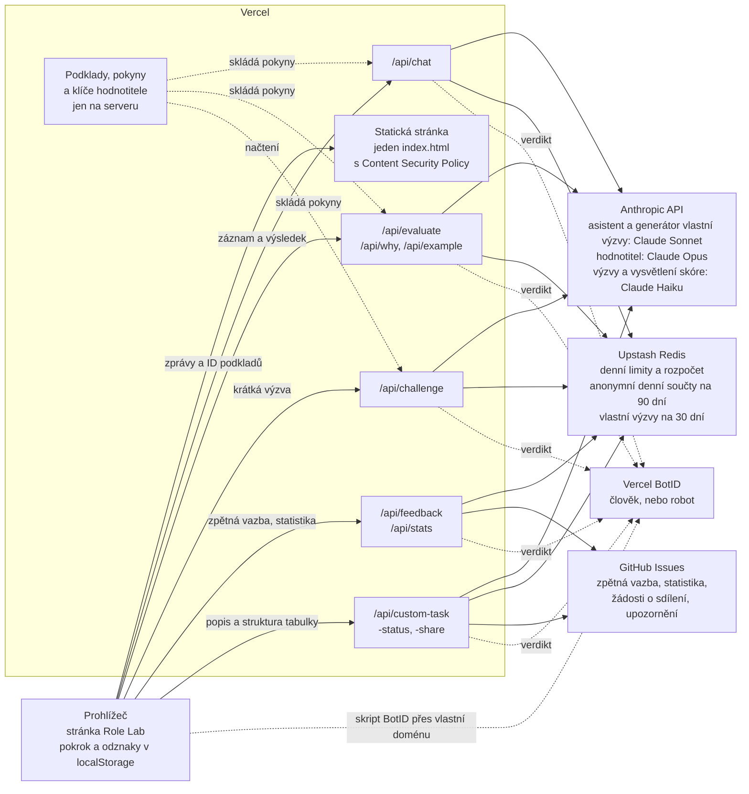
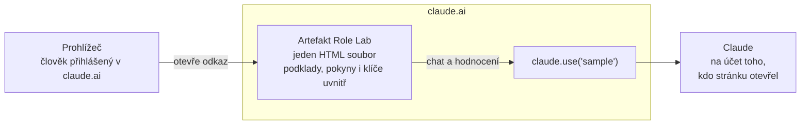
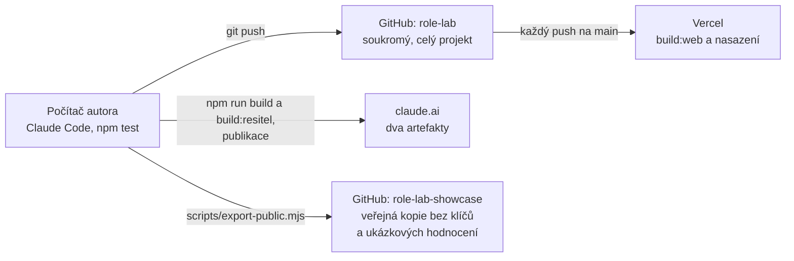

# Architektura

Role Lab běží ve dvou podobách z jednoho kódu. Veřejná webová verze má vlastní server na Vercelu. Verze v claude.ai je jeden HTML soubor bez serveru, který volá Clauda přes účet toho, kdo stránku otevře. Schémata níž GitHub vykreslí sám (Mermaid). Přehledové schéma v README jsou obrázky `docs/architecture-light.svg` a `docs/architecture-dark.svg`. Kreslí je `node scripts/build-architecture-diagram.mjs`, po změně infrastruktury je potřeba upravit obojí.

## Webová verze

[role-lab-gamma.vercel.app](https://role-lab-gamma.vercel.app), sestavuje ji `npm run build:web`.

- **API klíč** k Anthropicu je jen v nastavení Vercelu. Do prohlížeče ani do repozitáře se nedostane.
- **Pokyny a klíč hodnotitele** skládá server. Prohlížeč posílá jen zprávy uživatele a ID podkladů. Asistent klíč nikdy nedostane.
- **Rozbor záludností** pošle server prohlížeči až s výsledkem hodnocení.
- **Celkovou úroveň** počítá kód podle konfigurace role a ověřuje, že citace v záznamu opravdu jsou.
- **Limity** se počítají pro každou osobu i celkem a nulují se každý den o půlnoci pražského času. Osoba je náhodné číslo, které si uloží prohlížeč. Jedna IP adresa má navíc strop zhruba čtyř lidí a ukládá se jen jako otisk, ne samotná adresa.
- **Server** přijímá požadavky jen z vlastní stránky.
- **Ochrana proti robotům** (Vercel BotID, od verze 2.7.0): stránka přidá ke každému volání AI, zpětné vazbě a vlastní výzvě podpis a server se Vercelu zeptá, jestli ho poslal člověk. Zatím jen zapisuje verdikt do anonymních denních součtů a nic neblokuje (`docs/PRODUCTION.md`, oddíl 3). Statistika `/api/stats` se neověřuje, posílá se i při zavírání karty.
- **Písmo** je od verze 2.6.0 z vlastní domény. Z cizích webů stránka nenačítá nic.
- **Vlastní výzva** (beta): prohlížeč pošle popis role a situace a z tabulky jen strukturu, hodnoty z ní neopustí prohlížeč. Server vygeneruje úkol, ověří, že záludnost je v datech, a uloží ho na 30 dní pod náhodným id. Klíč k záludnosti zůstává na serveru. E-maily, rodná čísla a čísla účtů odmítne stránka i server. Sdílení s kolegy schvaluje autor příkazem `npm run custom-task`, který umí generování i vypnout.

## Verze v claude.ai

Ukázková (`npm run build`) a pro řešitele (`npm run build:resitel`), publikované jako artefakty v claude.ai.

- Žádný server, API klíč ani databáze. Útratu nese účet toho, kdo stránku používá.
- Bez serveru musí být klíč hodnotitele uvnitř stránky. Proto je pro veřejnost hlavní webová verze.
- Verze pro řešitele vynechává kalibraci a ukázková hodnocení, které záludnosti rozebírají.

## Vývoj a vydání

Přehled změn v každé verzi je v `CHANGELOG.md`.
