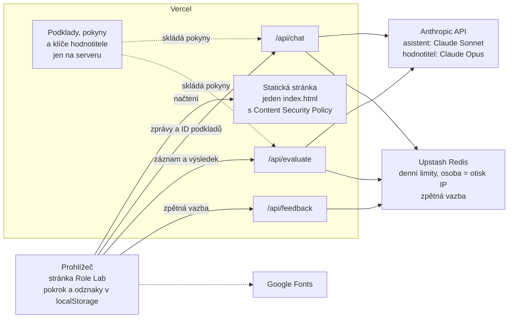
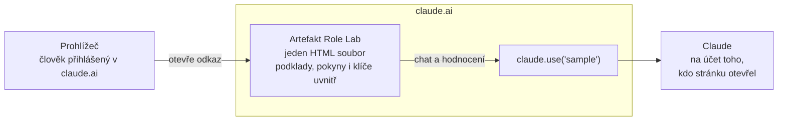
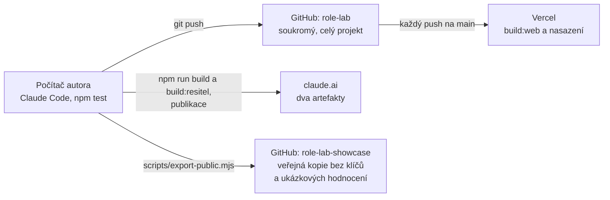

# Architektura

Role Lab běží ve dvou podobách z jednoho kódu. Veřejná webová verze má vlastní server na Vercelu. Verze v claude.ai je jeden HTML soubor bez serveru, který volá Clauda přes účet toho, kdo stránku otevře. Schémata níž GitHub vykreslí sám (Mermaid).

## Webová verze

[role-lab-gamma.vercel.app](https://role-lab-gamma.vercel.app), sestavuje ji `npm run build:web`.

- **API klíč** k Anthropicu je jen v nastavení Vercelu. Do prohlížeče ani do repozitáře se nedostane.
- **Pokyny a klíč hodnotitele** skládá server. Prohlížeč posílá jen zprávy uživatele a ID podkladů. Asistent klíč nikdy nedostane.
- **Rozbor záludností** pošle server prohlížeči až s výsledkem hodnocení.
- **Celkovou úroveň** počítá kód podle konfigurace role a ověřuje, že citace v záznamu opravdu jsou.
- **Limity** se počítají pro každou osobu i celkem a nulují se každý den o půlnoci pražského času. Osoba je jen otisk IP adresy, ne samotná adresa.
- **Server** přijímá požadavky jen z vlastní stránky.

## Verze v claude.ai

Ukázková (`npm run build`) a pro řešitele (`npm run build:resitel`), publikované jako artefakty v claude.ai.

- Žádný server, API klíč ani databáze. Útratu nese účet toho, kdo stránku používá.
- Bez serveru musí být klíč hodnotitele uvnitř stránky. Proto je pro veřejnost hlavní webová verze.
- Verze pro řešitele vynechává kalibraci a ukázková hodnocení, které záludnosti rozebírají.

## Vývoj a vydání

Přehled změn v každé verzi je v `CHANGELOG.md`.
